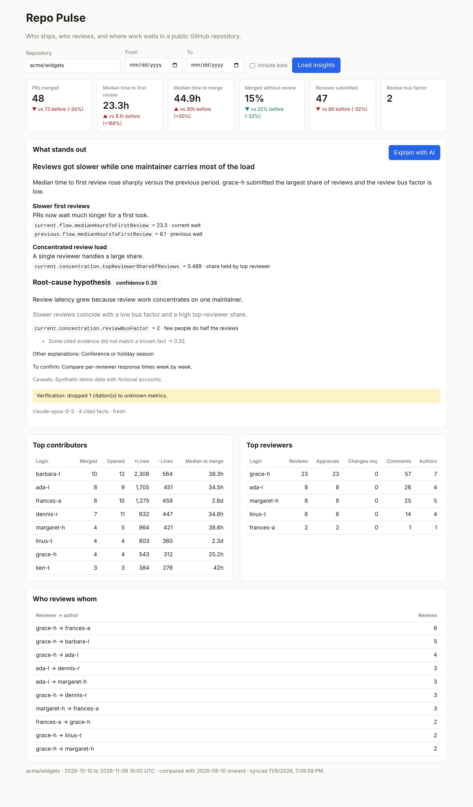
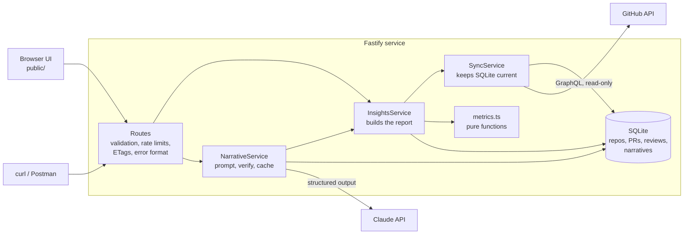
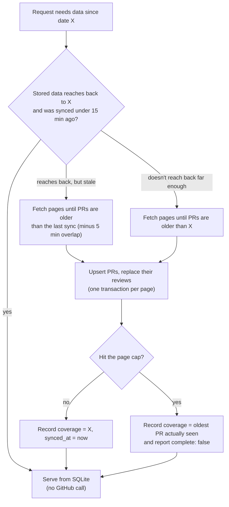
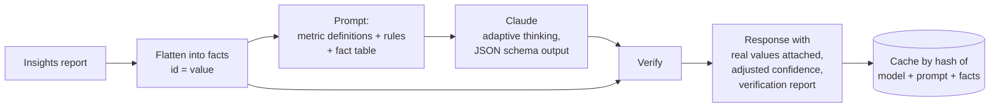

# Repo Pulse

**Repo Pulse reads the pull request and code review history of any public GitHub repository and tells you who ships, who reviews, and where work waits. It then asks Claude to explain what is unusual, and checks every claim the model makes against the real numbers before showing it.**

Built for the Loop home assignment. TypeScript, Fastify, SQLite, GitHub GraphQL API, Anthropic Claude.



<sub>Screenshot uses synthetic data with fictional accounts. The yellow box at the bottom of the AI section is the verification layer catching a citation the model made up.</sub>

---

## Contents

1. [What it does](#what-it-does)
2. [Quickstart](#quickstart)
3. [How it works](#how-it-works)
   - [Architecture](#architecture)
   - [Life of a request](#life-of-a-request)
   - [Syncing from GitHub](#syncing-from-github)
   - [Computing the metrics](#computing-the-metrics)
   - [The AI narrative and how it is kept honest](#the-ai-narrative-and-how-it-is-kept-honest)
4. [The metrics and why I chose them](#the-metrics-and-why-i-chose-them)
5. [API reference](#api-reference)
6. [Security](#security)
7. [Performance and caching](#performance-and-caching)
8. [Testing](#testing)
9. [Project layout](#project-layout)
10. [Configuration](#configuration)
11. [Trade-offs and what's next](#trade-offs-and-whats-next)

---

## What it does

| Requirement from the brief | Where it lives |
| --- | --- |
| Integrate with an external API | GitHub GraphQL API: PRs, reviews and review comments in one paginated query (`src/github/client.ts`) |
| An HTTP endpoint with an insight over a period | `GET /api/v1/repos/{owner}/{repo}/insights?from=&to=` |
| A second endpoint where an LLM writes a narrative with a hypothesis, confidence score and evidence chain | `GET /api/v1/repos/{owner}/{repo}/insights/narrative?from=&to=` |
| Document the metric and why | [The metrics and why I chose them](#the-metrics-and-why-i-chose-them) |
| Queryable over HTTP | REST, JSON, standard error format, ETags |
| Runnable locally | `npm run dev` or `docker compose up` |
| Storage and caching | SQLite with incremental sync, plus a narrative cache |
| Lightweight frontend | One static page at `/`, no build step |

The insight goes past a leaderboard. For any window you get:

- **Top contributors**: PRs merged into the default branch, PRs opened, lines changed, median time to merge.
- **Top reviewers**: reviews, approvals, changes requested, inline comments, and how many different authors each person reviews.
- **Flow**: how long PRs wait for a first review and to merge (median and 90th percentile), how many merge with no review, how big PRs are.
- **Concentration**: the "review bus factor", the fewest people doing half of all reviews.
- **Who reviews whom**: reviewer to author pairs, which show silos.
- **Change over time**: every headline number compared with the period of the same length right before.

The narrative endpoint hands those numbers to Claude and gets back a headline, a short summary, observations, a root-cause hypothesis with a confidence score, and an evidence chain where every link points to one exact number.

---

## Quickstart

**You need:** Node.js 22.13 or newer (24 LTS recommended) and a GitHub token. A [fine-grained token](https://github.com/settings/personal-access-tokens/new) with **Public repositories (read-only)** and no other permissions is enough. GitHub's GraphQL API needs a token even for public data. An [Anthropic API key](https://console.anthropic.com/) is optional and only turns on the narrative endpoint.

```bash
git clone https://github.com/aaronkantrowitz/loop.git && cd loop
npm install
cp .env.example .env     # fill in GITHUB_TOKEN, and ANTHROPIC_API_KEY for the AI narrative
npm run dev              # open http://localhost:3000
```

Or with Docker:

```bash
GITHUB_TOKEN=ghp_... ANTHROPIC_API_KEY=sk-ant-... docker compose up --build
```

Try it from the command line:

```bash
# Metrics for October 2026
curl -s "localhost:3000/api/v1/repos/fastify/fastify/insights?from=2026-10-01&to=2026-10-31" | jq .current.flow

# The AI narrative for the same period
curl -s "localhost:3000/api/v1/repos/fastify/fastify/insights/narrative?from=2026-10-01&to=2026-10-31" | jq .narrative
```

The first request for a repository pulls its history from GitHub, which takes a few seconds for most repos. After that, requests are served from SQLite and only new activity is fetched.

---

## How it works

### Architecture



Each box has one job and talks to the others through small interfaces. GitHub and Claude both sit behind interfaces (`GitHubSource`, `NarrativeModel`), so tests replace them with fakes and nothing in the test suite touches the network.

### Life of a request

Here is what happens on `GET /api/v1/repos/fastify/fastify/insights?from=2026-10-01&to=2026-10-31`:

1. **Validate.** The owner and repo name are checked against GitHub's naming rules, and the query string against a zod schema. Bad input gets a `400` before any work happens.
2. **Resolve the period.** `to=2026-10-31` is a plain date, so it includes that whole day and becomes `2026-11-01T00:00Z`. The window is `[from, to)` in UTC. The service also works out the previous period of the same length (September 1 to October 1) for comparison.
3. **Make sure the data is there.** `SyncService` checks SQLite: are all PRs active since September 1 stored, and was the last sync less than 15 minutes ago? If yes, it skips GitHub entirely. If not, it fetches only what's missing (next section).
4. **Load and compute.** Every PR updated since September 1 is read from SQLite with its reviews. The same pure function then runs once for the current window and once for the previous one.
5. **Compare.** Headline metrics are paired up into `changes`: current, previous, delta and relative change.
6. **Respond.** JSON with an `ETag`. If the browser already holds that version it gets `304 Not Modified`.

The narrative endpoint does steps 1 to 5 the same way, then hands the report to the narrative pipeline described below.

### Syncing from GitHub

GitHub's GraphQL API can list a repository's PRs **sorted by last update, newest first**. The sync logic rests on one observation: if a PR was opened, reviewed or merged inside a window, its `updatedAt` is at or after the start of that window. So walking pages from newest to oldest and stopping at the first PR updated before `from` collects every PR that can affect the numbers.



How it plays out:

- **First request** for a repo: walks back to the start of the previous period. For a busy repo over 60 days that's a handful of requests, 50 PRs each.
- **Later requests within 15 minutes**: zero GitHub calls.
- **After 15 minutes**: one or two calls to pick up what changed, with a 5-minute overlap to absorb clock skew.
- **Huge repos**: a page cap (`SYNC_MAX_PAGES`, default 40, which is 2,000 PRs) stops one request from draining the rate limit. When it triggers, the service records only the range it really covered and the response says `"complete": false` instead of quietly undercounting.
- **Several requests at once** for the same repo queue behind one sync, so a burst of traffic costs a single round of GitHub calls.

One GraphQL query returns PRs with their reviews and review comment counts nested inside. Getting the same from the REST API would take a list call plus one or two calls per PR.

### Computing the metrics

`src/insights/metrics.ts` is a pure function: PRs in, numbers out, no database or network. That makes every number testable with small hand-built fixtures, and lets the same code compute both the current and the previous period.

It walks the PR list once. For each PR it checks whether the PR was opened in the window, merged into the default branch in the window, and which reviews were submitted in the window, then updates per-person tallies in hash maps. Sorting the final lists is the only step above linear time. Percentiles use the nearest-rank method. A metric with no data (say, median time to merge when nothing merged) comes back as `null`, never `0`, because a zero there would be a false claim.

### The AI narrative and how it is kept honest

A language model given a table of numbers will happily invent a figure or cite something that isn't there. The design treats Claude as a smart but untrusted analyst: it reasons about the data, and the server checks its work before anyone sees it.



**Step 1: Turn the report into facts.** Every number gets a stable, readable ID:

```text
current.flow.medianHoursToFirstReview = 23.3
previous.flow.medianHoursToFirstReview = 8.1
change.flow.medianHoursToFirstReview.deltaRatio = 1.877
current.reviewers[grace-h].reviews = 23
current.concentration.reviewBusFactor = 2
```

**Step 2: Ask Claude.** The system prompt defines every metric precisely and sets the rules: cite facts by exact ID, only use numbers from the table, set the hypothesis to `null` if the data doesn't support one, and use a stated scale for confidence. The request uses the Anthropic SDK's structured output (`output_config.format` with a zod schema), so the response always matches the expected shape. Adaptive thinking lets the model reason before it answers. If a safety filter declines the request, server-side fallback retries on another model inside the same call.

**Step 3: Verify.** `src/narrative/verify.ts` checks the response against the facts:

| Check | What happens |
| --- | --- |
| Every cited fact ID must exist | Unknown IDs are dropped and listed in `verification.unknownFactIds`. An observation left with no valid evidence is removed. |
| Values come from the server | The `value` shown next to each citation is looked up in our data. The model never writes the numbers in the evidence chain. |
| Every number in the prose must match a fact | Allows rounding, ratio to percent (0.271 to 27%) and hours to days. Anything else goes in `verification.unverifiedNumbers`. |
| Confidence is calibrated | The model's own score is kept as `modelConfidence`. The final `confidence` is scaled down for bad citations or unverified numbers, capped at 0.6 below 20 merged PRs and 0.3 below 5, and reduced if the sync was incomplete. Every adjustment is listed with its reason. |

`verification.grounded` is `true` only when nothing had to be dropped or flagged. The UI shows a warning whenever it's `false`.

**Step 4: Cache.** The result is stored under a hash of the model, prompt version and facts. Asking the same question again costs nothing, and changing the prompt (which bumps `PROMPT_VERSION`) or getting new data produces a fresh answer.

**Prompt injection defense.** PR titles and descriptions are written by anyone on the internet and could contain instructions aimed at the model. They are never fetched or sent. Claude sees only numbers and GitHub usernames, which GitHub restricts to letters, digits and hyphens.

---

## The metrics and why I chose them

I focused on **review flow** rather than a plain commit leaderboard. Commit counts mostly measure how people split their work into commits. What hurts teams is work that sits waiting and review that rests on one or two people, so the metrics are built to show that, with the classic contributor and reviewer rankings alongside.

| Metric | Exact definition | Why it matters |
| --- | --- | --- |
| `flow.prsMerged` | PRs merged **into the default branch** during the window | Delivered work. Backport branches are left out so a fix isn't counted twice. |
| `flow.prsOpened` | PRs created during the window | Incoming demand on reviewers |
| `flow.medianHoursToFirstReview`, `flow.p90HoursToFirstReview` | Time from PR creation to the first review by someone other than the author, over PRs merged in the window | The wait authors actually feel. The 90th percentile shows the long tail the median hides. |
| `flow.medianHoursToMerge`, `flow.p90HoursToMerge` | Time from creation to merge, over PRs merged in the window | End-to-end cycle time |
| `flow.mergedWithoutReviewRate` | Share of merged PRs with no review from anyone but the author before the merge | Review coverage. A review left after merging doesn't count. |
| `flow.medianLinesChangedPerPr`, `flow.largePrShare` | Size of merged PRs. "Large" means over 500 changed lines. | Large PRs are a common cause of slow reviews, and a natural thing for the hypothesis to check |
| `concentration.reviewBusFactor` | The fewest reviewers who together did at least half of all reviews | 1 or 2 means review depends on very few people |
| `concentration.topReviewerShareOfReviews`, `topAuthorShareOfMerges` | Share of the total held by the top person | The same risk, seen through one person |
| `contributors[]` | Per author: PRs opened, PRs merged, lines added and deleted on merged PRs, median hours to merge | The classic "top contributors" view |
| `reviewers[]` | Per reviewer: reviews, approvals, changes requested, inline review comments, distinct PRs reviewed, distinct authors reviewed | "Top reviewers", with breadth shown next to volume |
| `reviewPairs[]` | How many reviews each reviewer gave each author | Shows silos and dependencies between people |
| `dataQuality` | PRs considered, PRs whose review list was cut at 100, bot events excluded | Shows anything that limits how far the numbers can be trusted |

**Rules applied everywhere**

- Windows are half-open, `[from, to)`, in UTC, so back-to-back windows never double count.
- Self-reviews never count. Draft (pending) reviews are ignored because only their author can see them.
- Bot accounts like dependabot are excluded unless you pass `includeBots=true`.
- Reviews count in the window they were submitted in, even if the PR merged earlier or later.
- Deleted GitHub accounts show up as `ghost`, matching GitHub's own convention.

---

## API reference

Base path: `/api/v1`. Every error uses the standard `application/problem+json` format ([RFC 9457](https://www.rfc-editor.org/rfc/rfc9457)) with a stable machine-readable `code`.

### `GET /repos/{owner}/{repo}/insights`

| Parameter | Default | Description |
| --- | --- | --- |
| `from` | 30 days before `to` | `YYYY-MM-DD`, or an ISO-8601 timestamp with a timezone |
| `to` | start of the current hour | A plain date includes the whole day. Future dates are clamped. |
| `limit` | `10` | Rows per ranked list, 1 to 100 |
| `includeBots` | `false` | Count bot accounts as authors and reviewers |

The period can span up to 180 days (`MAX_PERIOD_DAYS`). Example response, trimmed:

```jsonc
{
  "repository": { "owner": "acme", "name": "widgets", "defaultBranch": "main", "url": "https://github.com/acme/widgets" },
  "period": { "from": "2026-10-10T19:00:00.000Z", "to": "2026-11-09T19:00:00.000Z" },
  "previousPeriod": { "from": "2026-09-10T19:00:00.000Z", "to": "2026-10-10T19:00:00.000Z" },
  "filters": { "includeBots": false, "limit": 10 },
  "data": { "syncedAt": "2026-11-09T19:09:59.000Z", "coverageFrom": "2026-09-10T19:00:00.000Z", "complete": true },
  "current": {
    "flow": { "prsOpened": 58, "prsMerged": 48, "prsMergedWithoutReview": 7, "mergedWithoutReviewRate": 0.146,
              "medianHoursToFirstReview": 23.3, "p90HoursToFirstReview": 39.6, "medianHoursToMerge": 44.9, "p90HoursToMerge": 68.5,
              "medianLinesChangedPerPr": 234, "largePrShare": 0 },
    "concentration": { "activeAuthors": 8, "activeReviewers": 5, "topAuthorShareOfMerges": 0.208, "topReviewerShareOfReviews": 0.489, "reviewBusFactor": 2 },
    "totals": { "reviews": 47, "approvals": 47, "reviewComments": 123, "linesAdded": 8614, "linesDeleted": 3290 },
    "contributors": [{ "login": "barbara-l", "prsOpened": 12, "prsMerged": 10, "linesAdded": 2308, "linesDeleted": 564, "medianHoursToMerge": 38.3 }],
    "reviewers": [{ "login": "grace-h", "reviews": 23, "approvals": 23, "changesRequested": 0, "reviewComments": 57, "prsReviewed": 23, "authorsReviewed": 7 }],
    "reviewPairs": [{ "reviewer": "grace-h", "author": "frances-a", "reviews": 6 }],
    "dataQuality": { "prsConsidered": 59, "prsWithTruncatedReviews": 0, "botEventsExcluded": 1 }
  },
  "previous": { "flow": { "...": "same shape" }, "concentration": { "...": "" }, "totals": { "...": "" } },
  "changes": [
    { "metric": "flow.medianHoursToFirstReview", "current": 23.3, "previous": 8.1, "delta": 15.2, "deltaRatio": 1.877 }
  ]
}
```

### `GET /repos/{owner}/{repo}/insights/narrative`

Takes the same `from`, `to` and `includeBots` parameters. Example response, trimmed:

```jsonc
{
  "narrative": {
    "headline": "Reviews got slower while one maintainer carries most of the load",
    "summary": "Median time to first review rose sharply versus the previous period...",
    "observations": [{
      "title": "Slower first reviews",
      "detail": "PRs now wait much longer for a first look.",
      "evidence": [
        { "factId": "current.flow.medianHoursToFirstReview", "value": 23.3, "interpretation": "current wait" },
        { "factId": "previous.flow.medianHoursToFirstReview", "value": 8.1, "interpretation": "previous wait" }
      ]
    }],
    "hypothesis": {
      "statement": "Review latency grew because review work concentrates on one maintainer.",
      "reasoning": "Slower reviews coincide with a low bus factor and a high top-reviewer share.",
      "modelConfidence": 0.7,
      "confidence": 0.35,
      "confidenceAdjustments": [{ "reason": "Some cited evidence did not match a known fact", "confidenceAfter": 0.35 }],
      "evidence": [{ "factId": "current.concentration.reviewBusFactor", "value": 2, "interpretation": "few people do half the reviews" }],
      "alternativeExplanations": ["Conference or holiday season"],
      "howToConfirm": "Compare per-reviewer response times week by week."
    },
    "caveats": ["..."],
    "verification": { "citedFacts": 4, "unknownFactIds": ["current.reviewers[ghost-user].reviews"], "unverifiedNumbers": [], "grounded": false }
  },
  "generation": { "model": "claude-opus-5-5", "promptVersion": "2026-11-09.1", "generatedAt": "...", "cached": false }
}
```

### Status codes

| Status | `code` | When |
| --- | --- | --- |
| `200` | | Success |
| `304` | | `If-None-Match` matches the current `ETag` |
| `400` | `invalid_request`, `bad_request` | Bad owner or repo name, bad dates, period too long, `limit` out of range |
| `403` | `forbidden` | Repo not on the `ALLOWED_REPOS` allowlist (when one is set) |
| `404` | `not_found` | Repo doesn't exist, is private, or the route is unknown |
| `429` | | Rate limit exceeded (60 per minute per IP, 6 for the narrative) |
| `502` | `upstream_error` | GitHub or Claude returned something unusable |
| `503` | `upstream_rate_limited`, `llm_rate_limited`, `llm_not_configured`, `upstream_auth`, `llm_auth` | A dependency is unavailable. Includes `Retry-After` when known. |

### Operational endpoints

- `GET /healthz`: liveness, always `{"status":"ok"}` while the process is up.
- `GET /readyz`: runs a database query and reports whether narratives are enabled.

---

## Security

| Concern | How it's handled |
| --- | --- |
| Secrets | Tokens come only from environment variables, are never logged (logger redaction is configured as a backstop), and `.env` is git-ignored. Config errors print field names, never values. |
| Least privilege | The GitHub token needs only public read access. Private repos are refused even if the token could read them, so a broadly scoped token can't leak private activity. |
| Injection and SSRF | The GitHub endpoint is a fixed URL. User input reaches GitHub only as GraphQL variables, never pasted into the query. Owner and repo names are checked against GitHub's own naming rules, which blocks path tricks like `..%2F`. Every SQL value is a bound parameter. |
| Prompt injection | The model never sees free text written by GitHub users, only numbers and usernames. |
| XSS | The UI builds the page with `textContent`, never `innerHTML`, and is served with a strict Content Security Policy (`default-src 'self'`) through helmet. |
| Abuse and cost | Per-IP rate limits, a much tighter one on the endpoint that calls Claude, a cap on period length, a cap on GitHub pages per sync, and an optional repo allowlist. |
| Error leaks | Unexpected errors are logged in full on the server and return a generic `500` to the client. |
| Container | Runs as the unprivileged `node` user with a health check. |

---

## Performance and caching

There are three cache layers, each tied to how often its data actually changes:

1. **SQLite holds the GitHub data.** Repeat queries never re-download history, and refreshes fetch only what changed. Requests for different windows of the same repo reuse the same stored data.
2. **ETags on the insights endpoint.** Periods without an explicit `to` end at the start of the current hour instead of the current millisecond, so the same question returns the same bytes, and clients revalidate with a cheap `304`.
3. **The narrative cache.** Identical inputs never pay for a second model call.

Other details:

- Metrics are a single linear pass over the PRs with hash maps, with no nested loops over large lists.
- Each GitHub page is saved in one database transaction. Database access is synchronous but limited to small indexed reads and writes, and payloads are capped at 50 PRs per page.
- GitHub calls have a 30-second timeout, retry transient 5xx errors with exponential backoff and jitter, and turn GitHub rate limits into `503` with `Retry-After` so clients know when to come back.

---

## Testing

```bash
npm test          # 45 tests, about 1 second, no network
npm run typecheck # TypeScript in strict mode
npm run lint      # Biome
```

| File | What it covers |
| --- | --- |
| `test/metrics.test.ts` | Window boundaries, default-branch filtering, self-review and bot rules, merged-without-review logic, percentiles, bus factor, nulls for empty data |
| `test/period.test.ts` | Default periods, inclusive dates, clamping to the current hour, rejected formats, previous-period math |
| `test/sync.test.ts` | Stops paging at the right PR, serves from cache when fresh, incremental refresh, partial coverage at the page cap, concurrent requests sharing one sync |
| `test/github-client.test.ts` | Mapping GraphQL responses to records, dropping pending reviews, bot detection, private and missing repos, rate limits, retries, malformed responses |
| `test/verify.test.ts` | Dropping unknown citations, server-attached values, number matching (rounding, percentages, days), confidence adjustments |
| `test/api.test.ts` | End-to-end HTTP through the real app with fake GitHub and Claude: response shape and numbers, ETag `304`, validation errors, `404`, allowlist `403`, hidden internal errors, narrative caching, `503` without a key, health checks, CSP header |

---

## Project layout

```text
src/
  server.ts               Entry point: loads config, wires real dependencies, graceful shutdown
  app.ts                  Builds the Fastify app from injected dependencies (used by tests too)
  config.ts               Environment variables validated with zod
  domain.ts               PullRequest and Review types shared by every layer
  errors.ts               Error classes that map to HTTP status codes
  github/client.ts        GraphQL query, response validation, retries, rate-limit handling
  ingest/sync.ts          Incremental sync and coverage tracking
  db/database.ts          SQLite connection and migrations
  db/store.ts             All SQL, as prepared statements
  insights/metrics.ts     Pure metric computation
  insights/period.ts      Parsing and validating time windows
  insights/service.ts     Builds the full report with period-over-period changes
  narrative/facts.ts      Flattens the report into citable facts
  narrative/prompt.ts     System prompt with metric definitions and rules
  narrative/schema.ts     Structured-output schema for the model
  narrative/verify.ts     Citation checks, number grounding, confidence calibration
  narrative/service.ts    Claude client, error mapping, caching
  routes/insights.ts      The two API endpoints
  http/error-handler.ts   Standard error responses
public/                   The dashboard (plain HTML, CSS and JS, no build step)
test/                     Vitest suites and fixtures
```

---

## Configuration

Copy `.env.example` to `.env`. Only `GITHUB_TOKEN` is required.

| Variable | Default | Purpose |
| --- | --- | --- |
| `GITHUB_TOKEN` | required | Read-only GitHub token |
| `ANTHROPIC_API_KEY` | unset | Turns on the narrative endpoint |
| `ANTHROPIC_MODEL` | `claude-opus-5-5` | Model for narratives |
| `ANTHROPIC_EFFORT` | `high` | How much reasoning the model does: `low` to `max` |
| `PORT`, `HOST` | `3000`, `127.0.0.1` | Where to listen (Docker sets `0.0.0.0`) |
| `DATABASE_PATH` | `./data/repo-pulse.db` | SQLite file location |
| `SYNC_TTL_MINUTES` | `15` | How long synced data counts as fresh |
| `SYNC_MAX_PAGES` | `40` | Max GitHub pages (50 PRs each) per sync |
| `MAX_PERIOD_DAYS` | `180` | Longest allowed window |
| `ALLOWED_REPOS` | empty (any) | Comma-separated allowlist like `fastify/fastify,nodejs/undici` |
| `RATE_LIMIT_PER_MINUTE` | `60` | Per-IP limit for most routes |
| `NARRATIVE_RATE_LIMIT_PER_MINUTE` | `6` | Per-IP limit for the narrative route |
| `LLM_TIMEOUT_MS` | `120000` | Timeout for each Claude call |
| `LOG_LEVEL` | `info` | Log verbosity |

---

## Trade-offs and what's next

The full write-up (architecture tour, trade-offs I'd revisit, next steps and how I used AI) is in **[NOTES.md](NOTES.md)**. In short:

- **SQLite** over Postgres: zero setup and plenty for a single instance. All SQL lives in one class, so swapping it is contained.
- **Sync during the request**: simple and always consistent, but the first request for a very large repo waits on GitHub. A background job queue is the next step at scale.
- **Reviews capped at 100 per PR**: rare, and reported in `dataQuality` rather than hidden.
- **Next**: an evaluation set to measure narrative quality, background sync, issue and CI signals, per-reviewer response times, and tracing on the GitHub and Claude calls.
